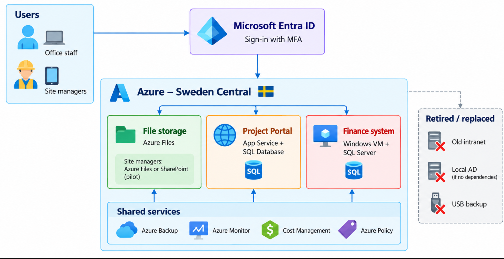
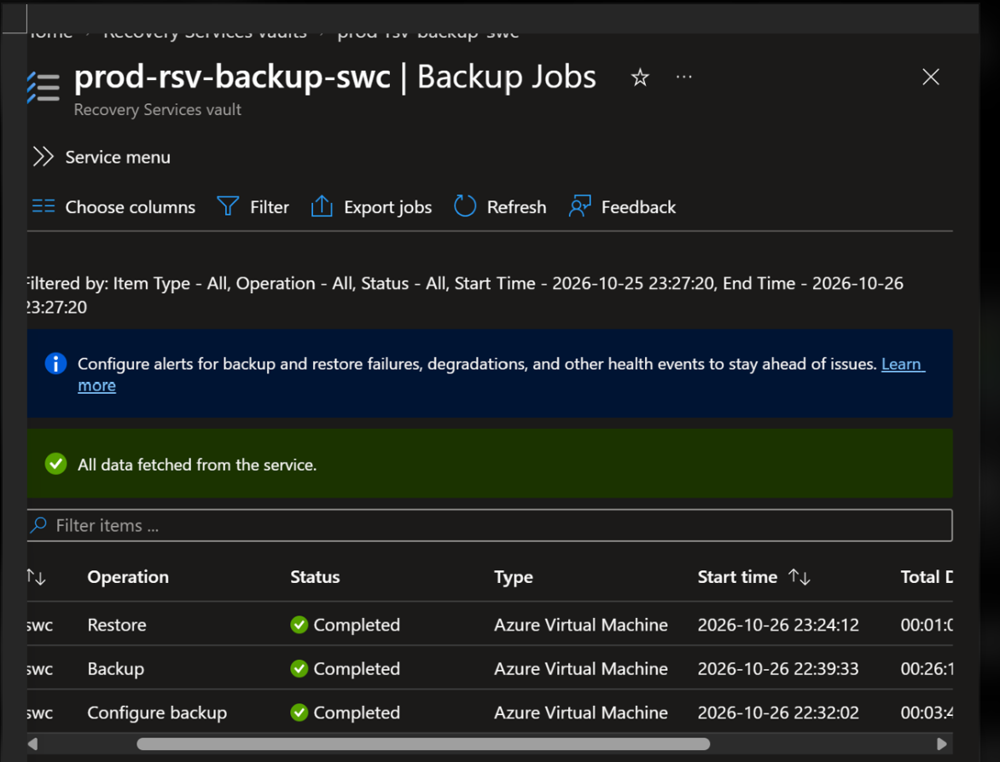
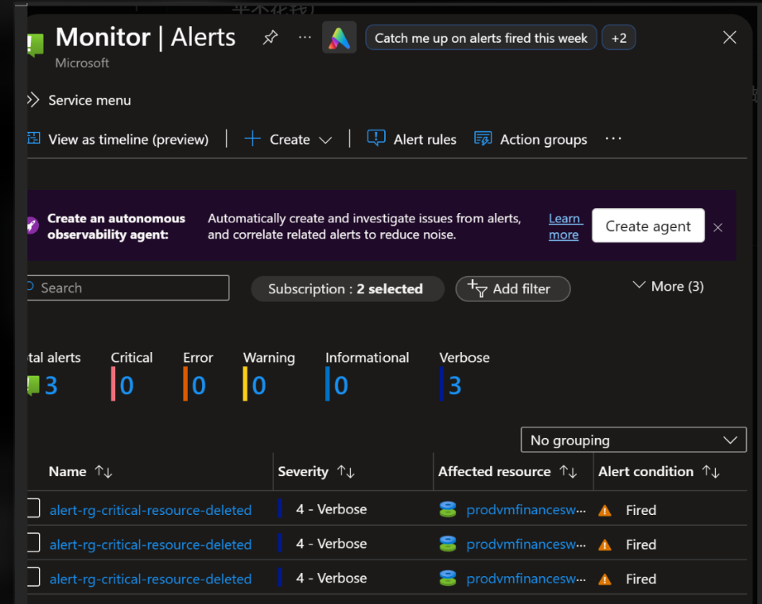

# Azure Migration – Vindö Bygg AB

A course project where I planned and built a small Azure environment for **Vindö Bygg AB**, a fictional construction company with 85 employees. The company wants to close its server room within six months and move to Azure.

I followed the seven methods of the **Microsoft Cloud Adoption Framework** (Strategy, Plan, Ready, Adopt, Govern, Secure, Manage). The lab is built with **Bicep** and deployed with one **PowerShell** script.

> This is a school lab (Lernia YH, October 2026). It uses test data only, and the company is fictional.

## Architecture



Users sign in with Microsoft Entra ID and MFA. Drawings move to Azure Files, the Project Portal moves to App Service and Azure SQL Database, and the finance system runs on a Windows VM. Backup, monitoring, cost control and policy are shared services. Everything runs in **Sweden Central** to keep data in the EU.

## Migration choices

| System | Path | Target |
|---|---|---|
| Active Directory | Replace | Entra ID |
| File server (2 TB drawings) | Replatform | Azure Files |
| Project Portal + SQL Server | Replatform | App Service + Azure SQL Database |
| Finance system | Rehost | Windows Server VM |
| Old intranet | Retire | Turned off |
| USB backup | Replace | Azure Backup |

## What the lab deploys

| Module | Resources | Key settings |
|---|---|---|
| `storage.bicep` | Storage account, Azure file share | 14-day soft delete for shares, blobs and containers; TLS 1.2; no public blob access |
| `web.bicep` | App Service plan (F1), web app | HTTPS only, FTP disabled, managed identity |
| `sql.bicep` | SQL server, SQL database (Basic) | Entra-only sign-in (no SQL password), geo-redundant backup |
| `vm.bicep` | Windows Server 2022 VM, VNet, NSG, public IP | Auto-shutdown at 19:00, RDP closed by default, patch assessment |
| `backup.bicep` | Recovery Services vault, policy, protected VM | Daily backup at 21:00, 7-day retention, GRS |
| `monitoring.bicep` | Action group, 2 alert rules | CPU above 80%, deletion of VMs, disks or vaults |

All resources have the tags `owner`, `env` and `avdelning` (department), so costs can be shown per department.

## Repository structure

```
infra/
  main.bicep            names, tags, parameters and module calls
  modules/              storage, web, sql, vm, backup, monitoring
app/
  index.html            start page for the Project Portal
scripts/
  deploy.ps1            checks, what-if preview, deployment, page upload
docs/images/            architecture and test screenshots
```

## How to deploy

You need Azure CLI with Bicep and permission to deploy to a resource group.

```powershell
az login
.\scripts\deploy.ps1 -WhatIfOnly   # preview only, nothing changes
.\scripts\deploy.ps1               # preview, confirm with y, then deploy
```

The script:

1. Checks that you are signed in to Azure
2. Reads your Entra ID account and uses it as the SQL administrator
3. Builds the Bicep code to catch errors early
4. Asks for the VM password with hidden input and runs `what-if`
5. Deploys after you confirm
6. Uploads the Portal start page

No passwords are stored in the code. The VM password is a `@secure()` parameter that you type when the script runs.

To deploy a separate test environment, change the `env` parameter (for example `env=dev`). All names are built from parameters.

## Tests and results

| Test | Result |
|---|---|
| VM backup and disk restore | Backup took 26 minutes, restore 1 minute, new disk created |
| File share soft delete | Deleted share and test file recovered |
| Deletion alert | Alert fired when the restored test disk was deleted |
| Portal website | Opens in the browser; HTTP redirects to HTTPS |
| Azure Advisor | 32 recommendations; 3 fixed in Bicep, the rest reviewed and explained |
| Redeploy from code | Script ran again with what-if first and updated the tags on all resources |





## Cost

Monthly estimate for the real company, from Azure Pricing Calculator:

- **Option A**, standard setup: about 6,282 SEK per month
- **Option B**, with savings: about 2,224 SEK per month (−65%)

The savings come from Azure Hybrid Benefit, running the finance VM on weekdays 07–19 only, and moving older drawings to the Cool tier. The lab itself has a budget of 300 SEK per month with alerts at 50%, 80% and forecasted 100%.

## What I learned

- **Check access first.** My PIM role expired and the first error message was unclear. Now I activate the role and sign in again before I start.
- **Read the defaults.** A Portal wizard created an extra backup vault and a lock that I did not plan.
- **Capacity is not unlimited.** The planned VM size was not available in Sweden Central, so I chose a similar size. Plan alternatives early.
- **Code makes changes easy.** I used the wrong tag names at first. Because everything was in Bicep, I fixed three lines and redeployed.

## Not in the code

- The monthly budget was created in the Azure portal.
- Identity (Entra groups, MFA, PIM) and Azure Policy are designed in the report but not deployed, because a student account does not have that permission.

Next steps for production: Defender for Cloud, private endpoints, immutable backups, zone-redundant storage, and the budget in Bicep for a full rebuild from code.

## Author

Xiaojing Wang
